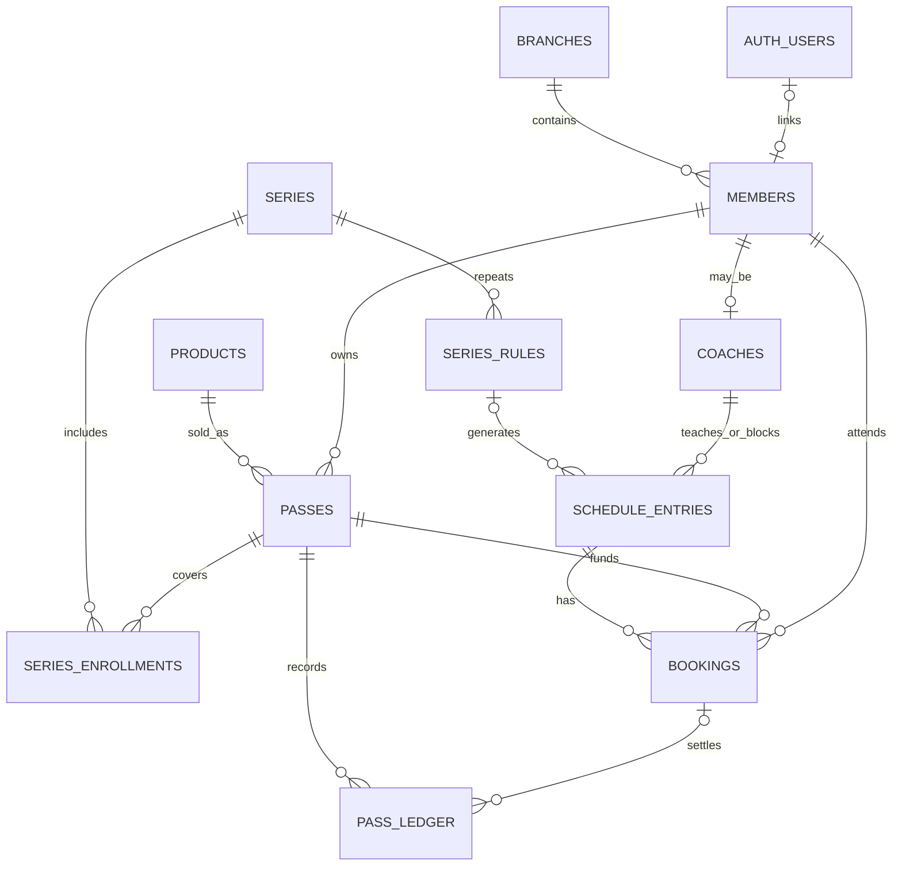

# 프로테니스 DB 설계안 v1

작성: 2026-11-12 · 대상: Supabase `protennis-dev`

상태: 2026-11-12 Supabase에 14개 테이블과 RLS/기본 제약조건 적용 및 롤백 검증 완료. Supabase Auth 연동 코드와 첫 코치 계정 연결도 완료했다. 상세 범위는 database-status.md 및 auth-setup.md 참고. 예약 트랜잭션 API·주차 생성·예약 화면의 DB 연결은 후속 작업이다. Google 원본 시트는 수정하지 않는다.

## 1. 설계 결정

- 주차별 테이블을 만들지 않는다. 날짜별 레슨을 저장하고 주 시작~다음 주 시작 범위로 조회한다.
- 정기 일정과 실제 레슨을 분리한다. 생성 이후 특정 날짜 변경은 다른 날짜나 반복 규칙을 바꾸지 않는다.
- 수업 한 건에 여러 참여자를 연결한다. 2:1 수업을 코치 일정 두 건으로 만들지 않는다.
- 예정 회차, 출석, 예약 상태, 실제 수강권 차감을 분리한다.
- 월 정기반의 주 2회를 임의로 월 8회권으로 변환하지 않는다.
- 표시만 20분 격자를 사용한다. 실제 시작·종료 시각은 10분 보강과 60분 원포인트도 표현한다.
- 이름을 식별자로 쓰지 않는다. 같은 이름의 회원도 UUID로 구분한다.
- 지점 시간대는 Asia/Seoul. 실제 시각은 timestamptz, 반복 요일·시각은 한국 현지 시간으로 저장한다.
- 로그인은 Supabase Auth로 이전하는 것을 목표로 한다. 기존 자체 HMAC 쿠키는 Supabase의 auth.uid()와 호환되지 않는다.

## 2. 관계

## 3. 테이블과 주요 필드

모든 업무 테이블은 UUID PK를 사용한다. 해당되는 행에는 branch_id, created_at, updated_at, created_by, version을 둔다. 업무 기록은 삭제보다 취소·비활성화를 사용한다. 금액은 정수 원 단위, 횟수는 정수로 관리한다.

| 테이블 | 주요 필드 | 역할 |
|---|---|---|
| `branches` | id, name, timezone | 지점. 최초 2호점 한 행 |
| `members` | id, branch_id, auth_user_id nullable unique, display_name, role, status | 계정과 별개의 회원 명부. 로그인 없는 기존 레슨생도 등록 가능. role은 admin/coach/student |
| `coaches` | member_id PK/FK, branch_id, active | 코치 자격·활동 상태. 표시 이름으로 권한을 판단하지 않음 |
| `products` | id, branch_id, name, kind, capacity, duration_minutes, price_krw, sessions_per_week nullable, total_sessions nullable, validity_months nullable, allowed_weekdays | 가격표 상품. regular/coupon/one_point/group |
| `passes` | id, branch_id, member_id, product_id, valid_from, valid_until, status, agreed_price_krw, agreed_kind, agreed_duration_minutes, agreed_capacity, agreed_weekdays, agreed_sessions_per_week nullable, granted_sessions nullable, cancellation_policy | 실제 계약. 상품 변경이 과거 계약을 바꾸지 않게 계약 조건을 복사해 보존. 월 정기반 총횟수 미확정이면 null |
| `series` | id, branch_id, product_id, capacity, booking_mode, status | 하나의 정기 수업 묶음. booking_mode=closed_roster/open_booking. 2:1은 기본 closed_roster |
| `series_rules` | id, branch_id, series_id, coach_id, iso_weekday, start_time, duration_minutes, valid_from, valid_until | 반복 규칙. 화·목이면 규칙 두 행. 기간은 현지 날짜 기준 |
| `series_enrollments` | id, branch_id, series_id, pass_id, member_id, valid_from, valid_until, status | 정기 수업 참여자와 수강권. 갱신 시 기존 계약을 덮지 않고 새 유효기간 행 생성 |
| `schedule_entries` | id, branch_id, coach_id, series_rule_id nullable, occurrence_date nullable, starts_at, ends_at, entry_type, status, capacity, booking_mode, product_id nullable, version | 날짜별 시간 점유. entry_type=lesson/blocked. lesson 상태는 draft/open/closed/completed/cancelled. 원래 발생 날짜는 일정 이동 후에도 보존 |
| `bookings` | id, branch_id, schedule_entry_id, member_id, pass_id, status, planned_session_no nullable, planned_total_snapshot nullable, attendance, credit_hold, source_booking_id nullable, request_id | 참여자별 예약. status=confirmed/cancelled, attendance=pending/present/absent/no_show. credit_hold는 쿠폰의 예약 확보분(0/1) |
| `pass_ledger` | id, branch_id, pass_id, booking_id nullable, delta_sessions, event_type, reverses_id nullable unique, operation_id unique, reason, created_by, created_at | 횟수 원장. 발급 +N, 차감 -1, 취소 복구 +1. 정정은 원래 행을 수정하지 않고 반대 항목 추가 |
| `audit_events` | id, branch_id, actor_id, operation_id, entity_type, entity_id, action, before_summary, after_summary, created_at | 변경 감사 기록. 비밀번호, 키, 불필요한 개인정보는 기록하지 않음 |

초기 운영 보조 테이블:

- `coach_open_windows`: id, branch_id, coach_id, starts_at, ends_at. 코치가 명시적으로 연 날짜별 예약 가능 범위. 창만으로 수업을 만들지는 않는다.
- `private.import_rows`: id, import_batch_id, source_sheet, source_cell, source_text, review_status, resolved_entity_id. 애매한 시트 기록의 검토 대기함. 파일/셀 단위 출처를 보존하고 원문을 공개 API에서 제외한다.

연락처가 필요해지면 회원 기본정보와 분리된 제한 테이블에 추가한다. 초기 시연에는 불필요한 연락처나 부상 상세를 수집하지 않는다.

## 4. 상품과 계약

예: 개인 평일 주 2회 20분 월 250,000원 상품은 kind=regular, capacity=1, sessions_per_week=2, total_sessions=null이다. 계약에서 화·목 조합을 정한다.

개인 쿠폰 5회 200,000원 상품은 kind=coupon, capacity=1, duration_minutes=20, total_sessions=5, validity_months=1이다. 만료 기준은 아직 정해지지 않았으므로 계약 등록 때 valid_from/valid_until을 명시한다.

2:1 금액은 사람당 계약 금액이다. 참여자마다 별도 수강권을 보유한다. 하나의 수업에 두 참여자가 연결되며 한 사람의 불참은 다른 사람의 수강권을 바꾸지 않는다.

10분 보강은 실제 길이 10분으로 등록하고 원예약을 source_booking_id로 연결한다. 10분을 0.5회로 임의 환산하지 않는다. 원예약이 이미 차감됐다면 승인된 보강의 추가 차감은 0으로 처리한다. 유료 부분 레슨은 정책 확정 전 자동 등록하지 않는다.

## 5. 예약·시간 충돌 방지

- `starts_at < ends_at`, capacity>0, 금액/횟수 유효 범위 CHECK.
- 지점이 다른 코치·회원·수강권을 잘못 연결하지 않도록 `(branch_id,id)` 복합 UNIQUE/FK를 적용한다.
- pass의 소유자와 booking.member_id 일치도 복합 FK `(pass_id,member_id)`로 보장한다.
- `(schedule_entry_id,member_id)` UNIQUE. 취소 후 재예약은 동일 행 상태 전이와 감사 기록을 사용한다.
- 생성 중복은 `(series_rule_id,occurrence_date)` UNIQUE로 차단한다. 취소된 일정도 이 키를 유지한다.
- `btree_gist`와 `tstzrange(starts_at,ends_at,'[)')` EXCLUDE로 같은 코치의 비취소 수업/차단 시간이 겹치지 않게 한다. 19:00–19:20 뒤에 19:20–19:40은 허용한다. 범위가 다른 테이블에 흩어지지 않도록 blocked와 lesson을 동일 테이블에 둔다.
- 완료된 수업도 역사적 점유로 남긴다. 취소된 수업만 충돌 검사에서 제외한다.
- 레슨생이 다른 코치 수업과 동시에 예약하지 못하도록, 모든 예약/시간변경 경로에서 회원 행을 잠그고 활성 예약 범위를 검사한다.
- 동일 회원의 미래 쿠폰 예약이 잔여 횟수를 초과하지 못하도록 pass 행 잠금 후 `원장 합계 - 활성 credit_hold 합계`를 계산한다.
- 회원/수강권/일정 잠금 순서를 전체 API에서 동일하게 고정한다. 여러 행은 UUID 순으로 잠근다. 일정 이동은 기존 참여자들을 잠근 뒤 version을 재확인하고 변경 시 재시도한다.
- 동시 예약 정원 확인은 수업 행을 잠근 뒤 수행한다. COUNT만 조회한 후 별도 API로 INSERT하는 방식은 금지한다.
- 코트 공유 운영 규칙이 확인되면 courts와 코트 시간 EXCLUDE를 추가한다. 현재는 코치의 동시 수업만 제한하며 코트 이중 사용까지 막는다고 주장하지 않는다.

예약 트랜잭션:

1. 서버가 로그인 사용자와 지점/역할을 검증한다. 레슨생 요청의 member_id는 서버가 정한다.
2. 중복 request_id를 확인하고 동일 요청이면 기존 결과를 반환한다. 다른 본문 재사용은 거절한다.
3. 회원 → 수강권 → 수업 순서로 잠근다. 새 수업 생성 요청은 coach 행도 정해진 상위 순서로 잠근다.
4. 과거 시간, 계약 기간·요일·레슨 유형, 명시적 open window, 차단 시간, 정원, 멤버 중복, 보유 횟수를 확인한다.
5. booking과 쿠폰 hold를 기록하고 감사 이벤트를 같은 트랜잭션에 저장한다.
6. 실패하면 전체 롤백한다. 중복/만석은 사용자에게 충돌 응답을 반환한다.

일정 수정·휴강·재예약·출석 확정도 서버의 정해진 작업으로 처리한다. 원장과 예약 상태 변경은 하나의 DB 트랜잭션에서 함께 처리한다.

## 6. 출석과 차감

- planned_session_no는 수업 전 예정 회차. 출석 클릭으로 증가시키지 않는다.
- 가입 시 이미 진행된 수업 수가 확인되면 시작 회차를 명시한다. 2주차에 3/8이라고 쓰여 있다는 이유만으로 계약 잔여 횟수를 추정하지 않는다.
- 쿠폰: 예약 시 hold=1, 출석 확정 시 hold=0과 ledger -1을 원자적으로 기록한다. 같은 확정을 재전송해도 중복 차감하지 않는다.
- 취소 가능 기간 내 취소는 hold 해제. 실제 차감 기록이 있을 때만 복구 원장을 쓴다.
- 코치 휴강은 예약 취소와 hold 해제, 기존 차감 복구를 한 작업으로 처리하고 필요하면 보강으로 연결한다.
- 개인 불참은 가격표상 자동 연기 불가. 불참 상태는 저장하되, 차감 여부/노쇼 기준이 확정되기 전에는 임의로 잔여 횟수를 변경하지 않는다.
- 총횟수가 없는 월 정기반은 금액/기간 계약 및 출석 이력을 관리하고 쿠폰 잔액 계산을 적용하지 않는다.
- 과거 회차 수정/일정 변경 때문에 후속 수업의 예정 회차를 자동 재번호하지 않는다. 필요 시 코치가 변경 내용을 확인하고 별도 수정한다.

## 7. 3·4주차 일정 생성

예시 정기 계약: 2026-11-01~2026-11-30, 화·목 19:00, 20분.

| 주 | 현지 발생 날짜 |
|---|---|
| 2주차 | 11월 10일, 12일 |
| 3주차 | 11월 17일, 19일 |
| 4주차 | 11월 24일, 26일 |

`generate_week(branch_id, week_start)`는 월요일 기준 날짜를 받는다. 해당 주와 규칙·등록·수강권 기간의 교집합만 생성한다. 처리 전 미리보기에서 생성 대상과 충돌을 보여준다. 같은 규칙/발생일의 일정은 덮어쓰지 않는다. 이미 생성된 회차의 참가자도 중복 추가하지 않는다. 취소/휴강된 회차를 재실행으로 부활시키지 않는다.

새 날짜를 만들 때 지난주 보강·불참·차감 메모는 복사하지 않는다. 신규 예약 출석은 pending이다. 같은 요청의 중복 실행은 동일한 결과를 반환한다. 충돌이 있으면 해당 주 생성 작업을 롤백하고 해결할 항목을 반환한다.

조회 예: 3주차는 한국 시간 `[2026-11-16 00:00+09, 2026-11-23 00:00+09)`에 겹치는 일정. 4주차는 11월 23~29일이다. ISO 연도/월/주차를 PK로 쓰지 않고 실제 날짜를 기준으로 한다.

## 8. 권한·인증 구조

권한 초안: 운영자는 소속 지점 전체, 코치는 본인 담당 수업과 참여자, 레슨생은 본인 예약/계약만 본다. 현재 시연은 코치가 모든 코치를 선택할 수 있으므로 실제 데이터 연결 시 이 범위를 제한해야 한다. 다른 코치 관리 권한은 운영자 역할로 명시적으로 부여한다.

| 자원 | 운영자 | 코치 | 레슨생 |
|---|---|---|---|
| 회원 명부 | 소속 지점 | 담당 수업 참여자의 필요한 정보 | 본인만 |
| 수업·차단 시간 | 소속 지점 편집 | 본인 담당 일정 편집 | 예약 가능 시간 요약, 본인 예약 정보 |
| 예약·출석 | 소속 지점 관리 | 본인 담당 수업 출석/예약 관리 | 본인 예약 요청·불참 알림 |
| 계약·횟수 원장 | 생성/정정 | 담당 수업에 필요한 요약, 정책에 따른 출석 확정 | 본인 조회 |
| 역할·로그인 연결 | 운영자만 | 변경 불가 | 변경 불가 |
| 원문 가져오기·감사 로그 | 소속 지점 운영자 | 기본 접근 없음 | 접근 없음 |

- public 업무 테이블 전체에 RLS를 켜고 필요한 SELECT 권한/정책만 명시한다. 자동 노출은 사용하지 않는다. API GRANT와 행 접근 정책은 별개다.
- members.auth_user_id를 Supabase auth.users(id)에 연결한다. role/지점/계정 연결은 사용자가 직접 수정할 수 없게 한다. user_metadata는 권한 판단에 사용하지 않는다.
- 로그인한 요청은 서버에서 검증한 Supabase 사용자 토큰으로 일반 읽기를 실행한다. 예약 가능 시간은 레슨생 이름 없이 별도 응답으로 반환한다.
- 여러 행을 바꾸는 예약/차감 작업은 Vercel 서버의 검증된 트랜잭션 경로로 제한한다. 초기안은 서버 전용 DB 연결로 고정된 매개변수 SQL 트랜잭션을 실행한다. 공개 Data API의 직접 INSERT/UPDATE/DELETE는 허용하지 않는다.
- 서버 DB 자격 증명은 RLS를 우회할 수 있으므로 모든 쓰기 작업에서 사용자·역할·지점·소유권을 명시적으로 확인한다. 브라우저가 넘긴 actor_id/role을 신뢰하지 않는다. 서버 전용 역할의 권한은 필요한 업무 테이블에만 한정한다.
- RLS에서 역할 테이블을 참조할 때 자기 테이블 재귀가 생기지 않도록 구현한다. 필요 시 비공개 스키마의 좁은 권한 조회 함수만 검토하고 사용자 확인·고정 search_path·최소 EXECUTE 권한을 적용한다.
- 공개 SECURITY DEFINER 함수나 전 역할 허용 정책으로 권한 오류를 해결하지 않는다. View 사용 시 security_invoker와 노출 컬럼을 함께 검토한다.
- 기존 자체 해시는 Supabase Auth로 그대로 복사하지 않는다. 운영자 초대/비밀번호 설정으로 계정을 이전하고 기존 세션을 종료한다. 로그인 이전이 완료되기 전 RLS가 기존 쿠키를 인식한다고 가정하지 않는다.

## 9. 인덱스와 검증

- schedule_entries(branch_id,coach_id,starts_at), bookings(member_id,status), bookings(schedule_entry_id,status), passes(member_id,status), pass_ledger(pass_id,created_at).
- 기간 조회/겹침은 GiST 범위 인덱스를 검토한다. 필요한 FK의 참조 방향 인덱스를 추가하고 이미 UNIQUE로 커버된 인덱스는 중복 생성하지 않는다.
- 트랜잭션 동시성 테스트: 마지막 자리 두 명 경쟁, 마지막 쿠폰으로 두 수업 경쟁, 같은 회원의 두 코치 동시 예약, 두 운영자의 일정 이동, 휴강과 예약 경쟁.
- 재시도 테스트: 주 생성 두 번, 출석 확정 두 번, 취소 복구 두 번, 취소 회차 재생성 방지.
- 권한 테스트: 미로그인 거절, 다른 지점 거절, 코치의 다른 담당 명부 거절, 레슨생의 다른 사람 예약 거절, role/회원 연결 위조 거절, 원문 메모 노출 금지.
- 시간 테스트: 한국 자정, 월/연도 경계, 10분 보강 겹침, 수강권 종료일, 19:20 경계의 연속 수업.
- 단계별 적용 후 Supabase advisors와 실제 테스트 쿼리로 검증한다. 현재 문서는 설계안이며 구현·실행 검증 완료를 의미하지 않는다.

## 10. 적용 순서와 미확정 규칙

1. 회원/코치/지점, 상품/계약의 마이그레이션 및 RLS 작성.
2. Supabase Auth 전환과 회원 연결. 비밀키는 Vercel 환경변수에만 저장.
3. 시트 원문을 검토용 비공개 영역으로 가져와 정기 일정과 수강권을 확인. 동명이인·색상·예정 회차를 추정해서 확정하지 않는다.
4. 날짜별 일정·예약 저장과 충돌 방지. 3·4주차 생성/주차 이동 UI 연결.
5. 출석/쿠폰 원장 연결 후 동시성·권한 검증. 학생 예약 UI 연결.

구현 전 운영자와 정할 규칙: 월 정기반의 5번째 주/공휴일, 쿠폰 만료 시작일, 당일 취소·노쇼 차감, 우천 보강 기한, 2:1 파트너 변경, 코트 동시 사용, 단체반의 29만원 적용 기간. 미확정 정책은 데이터로 표현하되 자동 청구·차감·보강을 활성화하지 않는다.

## 공식 근거

- [PostgreSQL 17 범위와 배제 제약](https://www.postgresql.org/docs/17/rangetypes.html#RANGETYPES-CONSTRAINT)
- [Supabase Data API 권한과 RLS](https://supabase.com/docs/guides/api/securing-your-api)
- [Supabase RLS](https://supabase.com/docs/guides/database/postgres/row-level-security)
- [Supabase 사용자 연결](https://supabase.com/docs/guides/auth/managing-user-data)

2026-11-12 changelog 확인. PG17.11 btree_gist 부동소수 NaN 기존 인덱스 변경사항은 새 UUID/시각 범위 설계에 직접 적용되지 않으며, 적용 시 실제 확장 상태를 확인한다.
